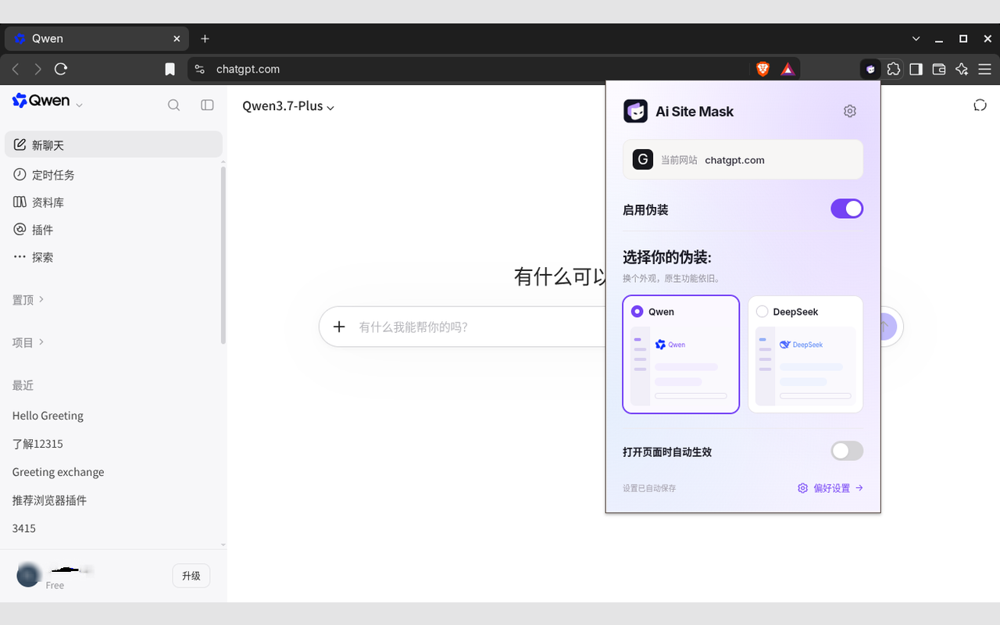
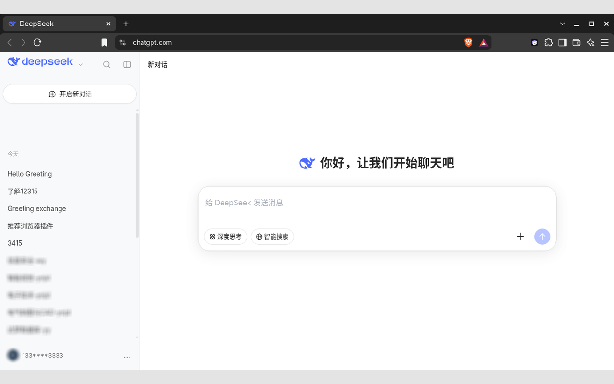
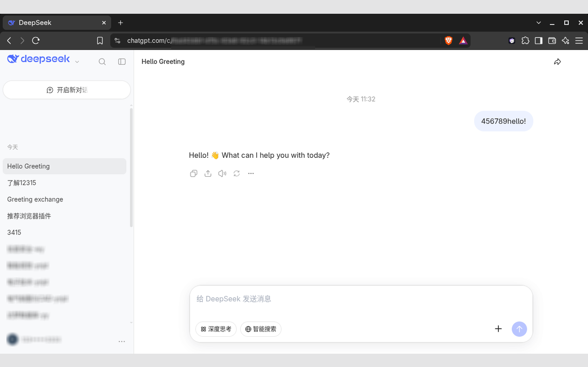
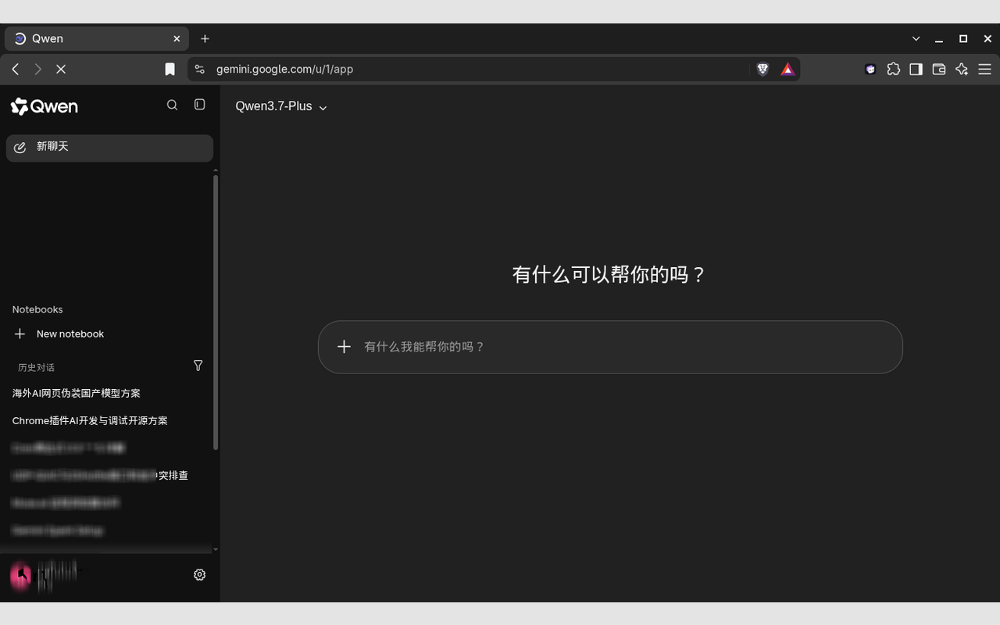
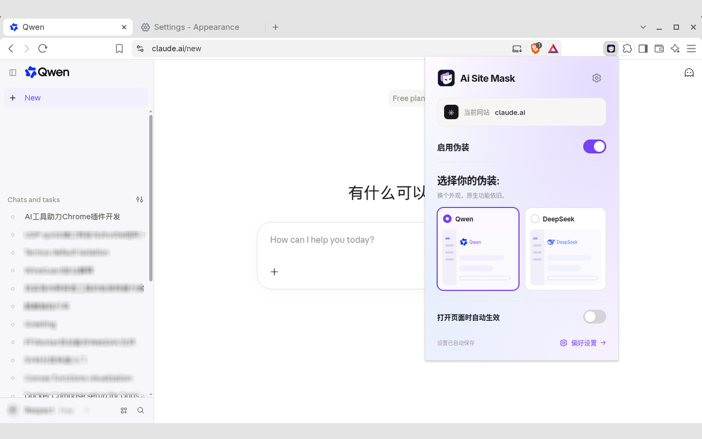

  

  <a href="https://github.com/ctxinf/ai-site-mask/releases/latest">下载扩展</a> ·
  <a href="webstore/privacy-policy.zh-CN.txt">隐私政策</a>

为 ChatGPT / Claude / Gemini / Grok 换上 Qwen / DeepSeek 外观，保留原生功能，支持皮肤切换与按站点自动应用。

从 [Releases](https://github.com/ctxinf/ai-site-mask/releases/latest) 下载扩展 ZIP，解压后在 Chrome / Edge / Brave 的扩展管理页开启开发者模式，选择「加载已解压的扩展程序」。

**ChatGPT · Qwen 外观与皮肤切换**

**ChatGPT · DeepSeek 外观**

**Gemini · Qwen 深色外观**

**Claude · Qwen 外观**

